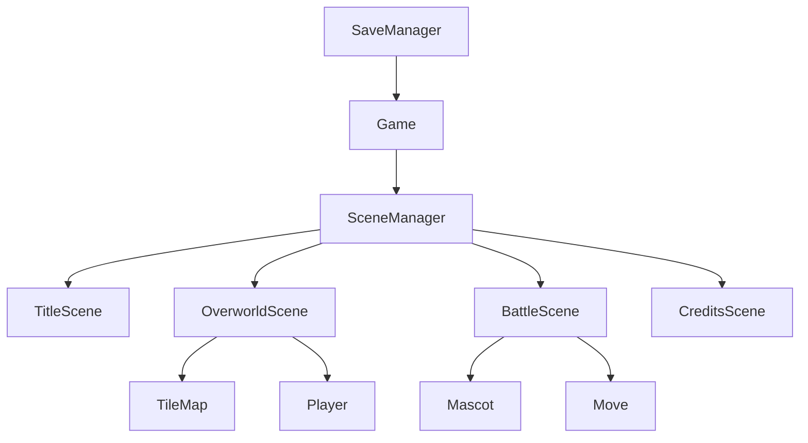

# Open-Mon Architecture

- **Game**: Main loop, input, timing
- **SceneManager**: State stack, transitions
- **Scenes**: Title, Overworld, Battle, Credits
- **TileMap/Player**: Overworld logic
- **Mascot/Move**: Battle logic
- **SaveManager**: Save/load JSON
