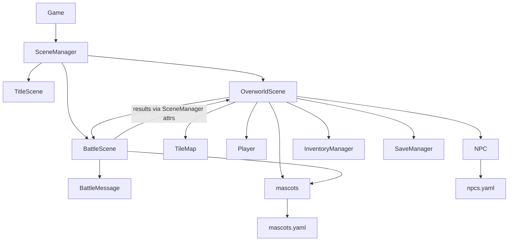

# Open-Mon Architecture

- **Game** (`src/engine/game.py`): 60 FPS loop; `dt` is in seconds.
- **SceneManager**: scene stack; only the top scene runs.
- **OverworldScene**: tile map, grid movement, NPC dialogue/trainers/healer,
  encounters, HUD, pause menu, save/load.
- **BattleScene**: turn-based battle. Logic resolves a turn immediately;
  `BattleMessage`s (text plus HP snapshot) replay it on screen.
- **mascots** (`src/engine/mascots.py`): species registry, type chart, wild
  encounter table and cached sprites, loaded from `assets/mascots.yaml`.
- **TileMap / Player** (`src/overworld.py`): CSV map (0 floor, 1 wall, 2 grass)
  and one-tile-at-a-time movement.
- **SaveManager**: JSON at `~/.openmon/save1.json` (player tile, party states,
  inventory, defeated trainers).

## Battle rules (current)

- Damage: `max(1, int((power + atk - defense) * type_multiplier))`.
- The faster mascot (`spd`) acts first; ties go to the player.
- Type chart: see `type_effectiveness` in `assets/mascots.yaml` (unlisted
  pairs are 1.0).
- Capture chance: `max(0.2, 1 - hp / max_hp)`; wild battles only; party max 5.
- Losing every mascot: the party is fully healed and you return to spawn.
